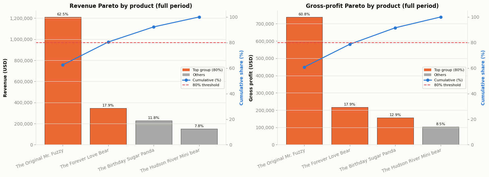
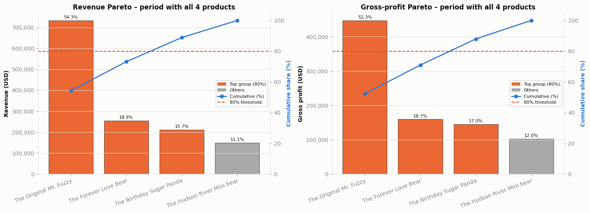
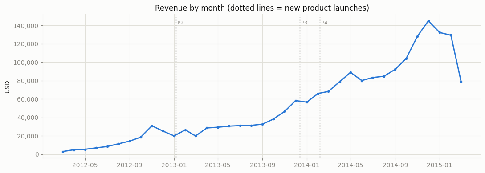

# Pareto Analysis – Maven Fuzzy Factory

Pareto (80/20) analysis of 3 years of sales data from an online toy store, to find **which products generate most of the revenue and gross profit**, and whether that picture still holds when products are compared over the same period.

**Tools:** Python (Pandas, NumPy, Matplotlib) · Jupyter Notebook

## Key findings

**1. Revenue is concentrated in one product, but the catalog is diversifying.** Over the full period, The Original Mr. Fuzzy accounts for 62.5% of revenue, and 2 of 4 products generate 80% of it. But Mr. Fuzzy was on sale up to 23 months longer than the others. Comparing only the period when all 4 products were sold (Feb 2014 – Mar 2015), its share drops to 54.3% and 3 products are needed to reach 80%.





**2. Gross profit is more spread out than revenue.** Mr. Fuzzy has the lowest gross margin (61.0%), while The Birthday Sugar Panda and The Hudson River Mini bear earn ~68.5%. Their share of gross profit is therefore higher than their share of revenue, and 3 products are needed to reach 80% of gross profit even over the full period.

**3. The store grew fast, with bigger and more profitable orders.** Revenue peaked at $144,823 in December 2014, and 2014 revenue was 2.7× that of 2013. Average order value rose from $49.99 (2012) to ~$63 (2014–2015) as the share of orders with a second product went from 0% to ~34%, and gross margin rose from 61.0% to 63.4%.



## Recommendations

- **Protect the flagship product.** Mr. Fuzzy still brings in over half of revenue and gross profit, so any supply or quality problem with it hits the business hardest.
- **Keep developing higher-margin products.** Sugar Panda and Mini bear earn ~68.5% gross margin; growing them reduces dependence on Mr. Fuzzy and lifts the overall margin.
- **Review Mr. Fuzzy's cost or price.** The best-selling product has the lowest margin, so even a small improvement has a large effect on total gross profit.

## Analysis questions

1. What are the overall KPIs: revenue, gross profit, number of orders, average order value (AOV), and how did they change by year?
2. How did revenue change over time?
3. Which products generate 80% of revenue and gross profit? Does the result change when products are compared over the same period?

## Workflow

1. **Data overview:** size, data types and sample rows of each table.
2. **Data cleaning**
   - Missing data: none in any table.
   - Duplicates: checked both full rows and content excluding the primary key.
   - Outliers: IQR on order value flagged 25.5% of orders, but they are real values (orders with 2 products, or the cheapest single product), so nothing was removed.
3. **Feature engineering:** an item-level table (`order_items` + product names) with gross profit (`price_usd − cogs_usd`); year / month columns.
4. **EDA:** KPIs overall and by year, monthly revenue trend.
5. **Pareto analysis:** revenue and gross profit by product, for the full period and for the period when all 4 products were on sale.
6. **Conclusions and recommendations.**

## Data

E-commerce data from the fictional online toy store Maven Fuzzy Factory, 19/03/2012 – 19/03/2015. Source: [Maven Analytics – Toy Store E-Commerce Database](https://fe.mavenanalytics.io/data-playground/toy-store-e-commerce-database). Table and column definitions are in `Data Dictionary.docx`.

| Table | Rows | Used for |
|---|---|---|
| `orders.csv` | 32,313 | One row per order: KPIs, average order value, cross-sell rate |
| `order_items.csv` | 40,025 | One row per product in an order: revenue and gross profit by product |
| `products.csv` | 4 | Product names and launch dates |

`order_item_refunds.csv` is included in the dataset but not used, since the analysis focuses on revenue and gross profit.

## Files

| File | Description |
|---|---|
| `Pareto_Analysis_English.ipynb` | Full analysis notebook (English) |
| `Pareto_Analysis_Vietnamese.ipynb` | Full analysis notebook (Vietnamese) |
| `*.csv` | Raw data (see above) |
| `Data Dictionary.docx` | Data dictionary |
| `requirements.txt` | Python packages needed |
| `images/` | Charts used in this README |

Both notebooks contain the same code and analysis; only the language differs.

## How to run

Requires Python 3 with Jupyter.

```bash
pip install -r requirements.txt
```

Open the notebook in Jupyter or VS Code, keep the CSV files in the same folder, then run all cells.

## Data limitations

- Only 4 products, so the classic "20% of products → 80% of revenue" split cannot appear; the analysis looks at how concentrated revenue is instead.
- 2012 (10 months) and 2015 (under 3 months) are partial years, so years are compared using average monthly revenue, not totals.
- Gross profit = price − cost of goods sold. It does not deduct refunds, shipping or marketing costs, so it is not net profit.
- Assumes primary and foreign keys between tables are correct as described in the data dictionary.
- No website session data, so conversion rates and marketing channels are not analysed.

## Author

Nguyễn Thùy An · [GitHub](https://github.com/annguyen68-crypto)
